# ML-Driven PVT Variation-Aware Leakage Estimation

Digital VLSI Design course project. Team **Watt the leak**.

Full technical report: [report/DVD_ML_Leakage_Report.docx](report/DVD_ML_Leakage_Report.pdf).


---

## Abstract

We estimate CMOS leakage under process, voltage and temperature (PVT) variation
using ML models of single transistors instead of full SPICE runs. The models are
validated in three steps: transistor → logic gate → 3-bit carry-lookahead adder (CLA).
Across 3,600 gate simulations the ML estimate has a **mean accuracy of 98.6 %**
(median error 0.91 %). Across 12,800 CLA simulations the loading-aware ML estimate
has a **mean accuracy of 98.4 %** (median error 0.97 %). The plain sum of gate
leakages that the spec asks for reaches only 69.4 %, because it leaves out
gate-tunnelling current between gates. That loss comes from the method, not
from the ML models.

| Level | Simulations | Median error | P95 error | Mean accuracy |
|---|---|---|---|---|
| Part A: transistor models (test set, per terminal) | 6,000 | 0.001–2.4 % | 0.4–7.4 % | n/a |
| Part B: gates (INV, NAND2, NOR2, AND2, OR2) | 3,600 | 0.91 % | 4.63 % | **98.59 %** |
| Part C: CLA, spec method (sum of gates) | 12,800 | 28.6 % | 63.3 % | 69.36 % |
| Part C: CLA, loading-aware | 12,800 | 0.97 % | 5.12 % | **98.40 %** |

---

## 1. Setup

### 1.1 Assignment

| Item | Value |
|---|---|
| Model file | `32nm_LP.pm`: PTM Low Power 32 nm, BSIM4 level 54 (not modified) |
| Nominal VDD | **0.9 V**, sampled 0.81–0.99 V. The card header says 1.0 V; 0.9 V is the assigned value. |
| L | 32 nm |
| W | 32–256 nm (1–8 × Lmin) |
| Temperature | −40 to 125 °C |
| Test circuit | 3-bit CLA, Cin = 0 (64 input vectors) |

Process parameters, each varied ±10 % and drawn separately for NMOS and PMOS:

| | vth0 (V) | toxe (m) | ndep (cm⁻³) | u0 (m²/V·s) | xj (m) |
|---|---|---|---|---|---|
| NMOS | 0.63 | 1.6e-9 | 4.12e18 | 0.042 | 5e-8 |
| PMOS | −0.5808 | 1.62e-9 | 3.07e18 | 0.016 | 1e-8 |

### 1.2 Environment

| Component | Version |
|---|---|
| OS | Windows 11 (10.0.26200) |
| Python | 3.11.9 |
| numpy / pandas / scipy | 2.4.6 / 3.1.0 / 1.17.1 |
| scikit-learn / joblib / matplotlib | 1.9.1 / 1.6.0 / 3.11.1 |
| Simulator | ngspice-46 (`C:/ngspice/Spice64/bin/ngspice_con.exe`) |

ngspice is not on PATH, so set its location in `project_config.json` → `paths.ngspice`.

```bash
pip install -r requirements.txt
python -m common_scripts.setup_check     # writes logs/setup_check.json
```

### 1.3 Setup check (result)

Latest run: [logs/setup_check.json](logs/setup_check.json). **Overall: PASS.**

| Check | Result | Detail |
|---|---|---|
| Python packages | PASS | all imported, versions above |
| ngspice | PASS | ngspice-46 found |
| Model-card nominals | PASS | card values match the table in 1.1 |
| Model-card patch | PASS | +10 % patch read back exactly; PMOS unchanged when only NMOS is patched |
| NMOS ON test run | PASS | Id = 21.7 µA, KCL sum = 2.8e-16 A |
| NMOS OFF test run | PASS | Id = 1.45 pA, KCL sum = 2.7e-27 A |
| PMOS ON test run | PASS | Id = −12.7 µA, KCL sum = −4.0e-17 A |
| PMOS OFF test run | PASS | Id = −1.22 pA, KCL sum = 4.4e-16 A |

### 1.4 Simulation conventions

* **Model card.** Only the five process parameters are replaced, inside the `nmos`/`pmos`
  block. The patched text is re-parsed to check every value and written to a private
  temp directory. The original card is never modified.
* **Netlists.** Values are written as literal numbers. Every terminal has its own source.
  All netlists include `.options gmin=1e-18 abstol=1e-18 reltol=1e-6 vntol=1e-9`, and
  results are printed with `set numdgt=15` (the default ~6 digits breaks the KCL check).
* **Run acceptance.** A run is accepted only if the exit code is 0, there is no error or
  non-convergence message, each output appears once, and every value is finite.
* **Sign convention.** Current is `-i(Vx)`, positive = into the device terminal, so
  `id + ig + is + ib = 0`.
* **Gate/circuit netlists** also use `.options itl1=1000 itl6=1000 pivrel=0.5` and a
  `.nodeset` at logic levels. Without these, 8 AND2 runs failed to converge and 5 converged
  to wrong solutions. Each run must also pass a physical self-check: the device currents
  into VDD equal the supply current within 1e-15 A + 0.1 %, and no node is more than 1 µV
  outside the rails.

---

## 2. Method

**Part A: transistor models.** We ran 40,000 ngspice simulations: 10,000 each for NMOS/PMOS
× ON/OFF, with uniform PVT and bias sampling. BSIM4 terminal currents are exact sums of 7
physical components: channel, 2 junction diodes, 3 gate-tunnelling paths and impact
ionisation. This decomposition was checked on all 40k samples to 1e-18 A. Each component
is learned as `log(|component| / physical normaliser)`, and its sign comes from a physics
rule that holds on 100 % of samples. The terminal currents are rebuilt by KCL-consistent
sums. Four model types (polynomial ridge, random forest, HGB, MLP) are compared, and the
best is chosen **per component** on the validation set.

The four terminal currents are rebuilt from the predicted components
([transistor_model.py](common_scripts/transistor_model.py), `compose_terminals`). All currents are
positive *into* the terminal. For an NMOS in forward mode (Vd ≥ Vs):

```
id =  ich + jd + isub − igcd
is = −ich + js − igcs
ig =  igcs + igcd + igb
ib = −jd − js − isub − igb
```

| Symbol | Component |
|---|---|
| ich | channel current, drain → source (subthreshold when OFF) |
| jd, js | drain–body and source–body junction diodes |
| isub | impact-ionisation substrate current |
| igcs, igcd | gate-to-channel tunnelling, source and drain shares (igcs + igcd = Igc) |
| igb | gate-to-body tunnelling |

The sum id + is + ig + ib = 0, so KCL holds by construction. In reverse mode (Vd < Vs) the drain
and source roles swap: id = −ich + jd − igcs and is = ich + js + isub − igcd. For PMOS the same
equations are evaluated on sign-flipped voltages, and all four currents are multiplied by −1.

Gate-to-channel tunnelling (Igc) is trained without drain-referenced features, following
BSIM4's own structure. Its drain/source split is a separate model that is exactly ½ at
Vds = 0. This change cut gate-level mean error from 5.2 % to 1.4 %.

**Part B: gates.** We ran 200 PVT corners × 18 (gate, input) cases = 3,600 SPICE runs. The ML
gate leakage is the current drawn from VDD. Each transistor's bias comes from the SPICE node
voltages. ON-transistor channel currents are closed by KCL at internal nodes instead of being
predicted, because their |Vds| ~ 1e-7 V is outside the training data.

**Part C: CLA.** The adder has 39 gates (24 NAND2, 9 AND2, 6 OR2) and 186 transistors.
We ran 64 vectors × 200 corners = 12,800 full-netlist SPICE runs. The **spec method** logic-simulates
the adder and sums each gate's Part-B ML leakage. The **loading-aware** method also adds
the ML gate-input current of every gate input held high by another gate.

Carry equations and the gates that build them ([cla.py](common_scripts/cla.py)). Carry-in c0 is
tied to 0. Each XOR is 4 × NAND2: n1 = NAND(x, y), n2 = NAND(x, n1), n3 = NAND(y, n1),
out = NAND(n2, n3).

| Signal | Logic | Instances | Gates |
|---|---|---|---|
| g<sub>i</sub> | a<sub>i</sub> · b<sub>i</sub> | gen0–2 | 3 AND2 |
| p<sub>i</sub> | a<sub>i</sub> ⊕ b<sub>i</sub> | xp0–2 | 3 XOR = 12 NAND2 |
| c<sub>1</sub> | g<sub>0</sub> + p<sub>0</sub>c<sub>0</sub> | u0, c1 | 1 AND2, 1 OR2 |
| c<sub>2</sub> | g<sub>1</sub> + p<sub>1</sub>g<sub>0</sub> + p<sub>1</sub>p<sub>0</sub>c<sub>0</sub> | t21, t22, o2, c2 | 2 AND2, 2 OR2 |
| c<sub>3</sub> | g<sub>2</sub> + p<sub>2</sub>g<sub>1</sub> + p<sub>2</sub>p<sub>1</sub>g<sub>0</sub> + p<sub>2</sub>p<sub>1</sub>p<sub>0</sub>c<sub>0</sub> | t31, t32, t33, o31, o32, c3 | 3 AND2, 3 OR2 |
| s<sub>i</sub> | p<sub>i</sub> ⊕ c<sub>i</sub> | xs0–2 | 3 XOR = 12 NAND2 |
| **Total** | | 39 gates | 24 NAND2, 9 AND2, 6 OR2 = 186 transistors |

Partial products are shared: t21 = p1g0 feeds both c2 and t32 = p2·t21, and t22 = p1·u0 feeds
both c2 and t33 = p2·t22.

---

## 3. Results

### 3.1 Part A: transistor models

Model comparison on the validation set (mean over terminals):

| Case | Poly ridge | Random forest | HGB | MLP |
|---|---|---|---|---|
| NMOS OFF, P95 error | 6.5 % | 31.9 % | 18.5 % | **3.0 %** |
| NMOS ON, P95 error | 29.5 % | 41.7 % | 20.5 % | **4.1 %** |
| PMOS OFF, P95 error | 6.4 % | 32.8 % | 17.0 % | **2.7 %** |
| PMOS ON, P95 error | 32.7 % | 38.9 % | 21.2 % | **4.8 %** |

Selected per-component models: polynomial ridge for the OFF-state subthreshold channel and
impact-ionisation currents, HGB for the NMOS OFF drain junction, and MLP for everything else.

Test-set error of the selected hybrid models (1,500 samples per case). Currents below
1e-15 A are excluded from the percentage errors.

| Case | Id median / P95 | Ig median / P95 | Is median / P95 | Ib median / P95 | Sign errors |
|---|---|---|---|---|---|
| NMOS ON | 0.84 / 3.09 % | 2.35 / 7.38 % | 0.84 / 3.09 % | 0.29 / 3.08 % | 0 |
| NMOS OFF | 0.002 / 0.72 % | below floor* | 0.45 / 2.38 % | 0.007 / 1.66 % | 0 |
| PMOS ON | 1.13 / 3.91 % | 1.52 / 4.43 % | 1.14 / 3.99 % | 0.45 / 7.07 % | 0 |
| PMOS OFF | 0.001 / 0.43 % | below floor* | 0.39 / 2.85 % | 0.36 / 1.97 % | 0 |

\* OFF-state Ig is below 1e-15 A in every test sample (absolute P95 error ≤ 2.2e-16 A).

All 40,000 samples pass the data checks: no failed runs, no missing values or duplicates,
no out-of-range inputs, and 0 KCL violations.

| | |
|---|---|
| 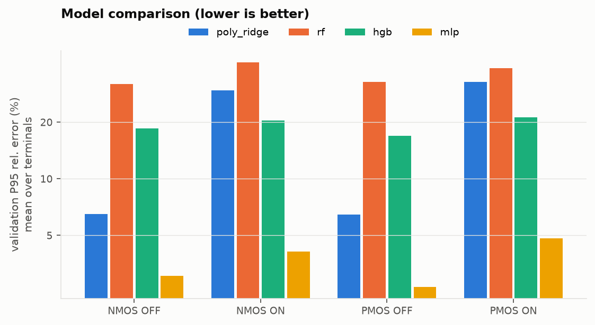 | 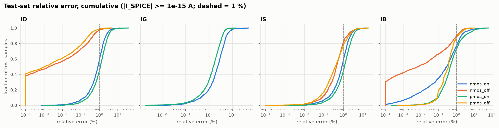 |
| 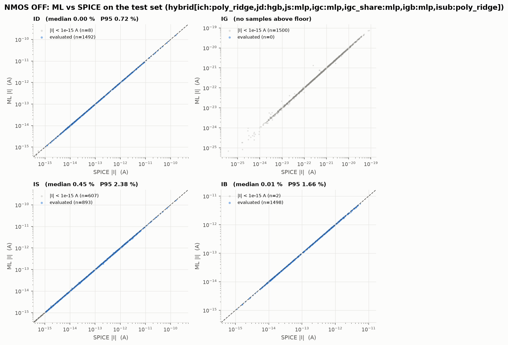 | 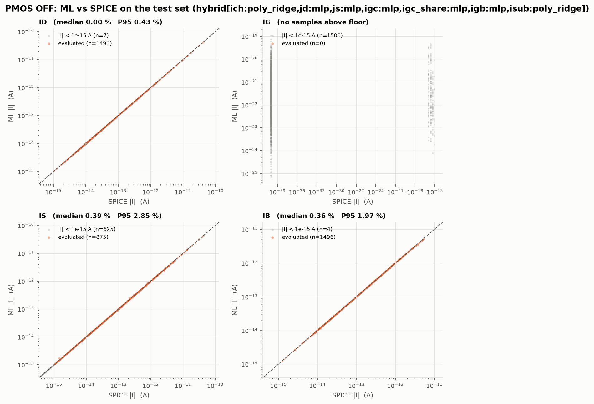 |

### 3.2 Part B: gate-level validation

3,600/3,600 SPICE runs pass the physical self-check.

| Gate | Inputs | SPICE median (A) | Median error | P95 error | Max error |
|---|---|---|---|---|---|
| INV | 0 / 1 | 2.19e-11 / 3.69e-12 | 1.44 / 0.57 % | 4.95 / 2.50 % | 9.6 % |
| NAND2 | 00 / 01 / 10 / 11 | 2.09e-11 … 7.39e-12 | 0.57–1.49 % | 2.49–5.74 % | 9.6 % |
| NOR2 | 00 / 01 / 10 / 11 | 4.39e-11 … 2.85e-13 | 0.19–1.44 % | 0.64–4.95 % | 9.6 % |
| AND2 | 00 / 01 / 10 / 11 | 7.38e-11 … 3.46e-11 | 0.87–1.10 % | 3.78–5.27 % | 8.9 % |
| OR2 | 00 / 01 / 10 / 11 | 9.98e-11 … 2.29e-11 | 0.95–1.40 % | 4.54–4.97 % | 9.5 % |
| **All** | 18 cases | 2.47e-11 | **0.91 %** | **4.63 %** | 9.6 % |

Overall bias −0.50 %, R² (log10) = 0.99989, 0 sign errors.
Per-case results: [layer2/outputs/gate_results_table.csv](layer2/outputs/gate_results_table.csv).

**Check of the method:** the same leakage formula, given SPICE's exact per-device currents
instead of ML ones, matches SPICE to a median relative error of ~1e-6
([oracle_check.csv](layer2/outputs/oracle_check.csv)). So the remaining gate error comes
from the ML models alone. KCL closure of ON channels lowers the median error from 7.2 %
(plain VDD-rail sum) to 1.9 %.

| | |
|---|---|
| 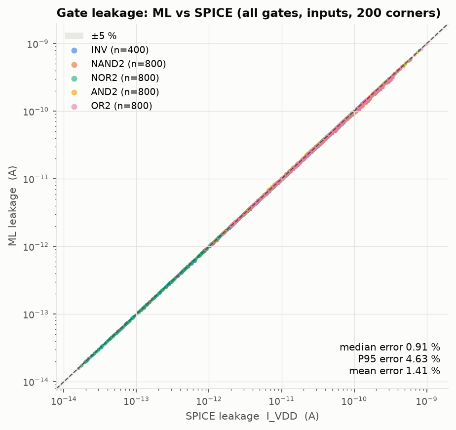 | 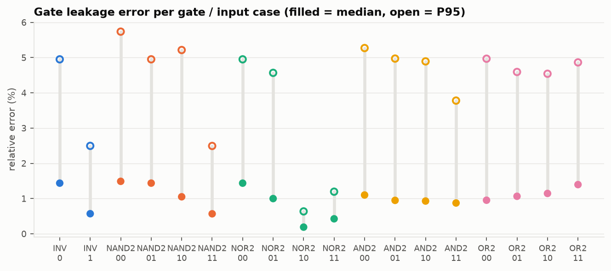 |
| 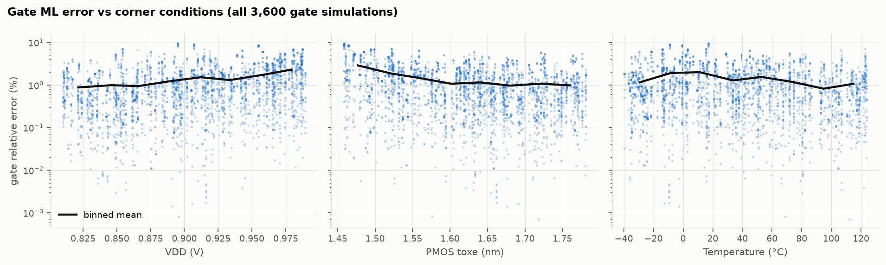 | 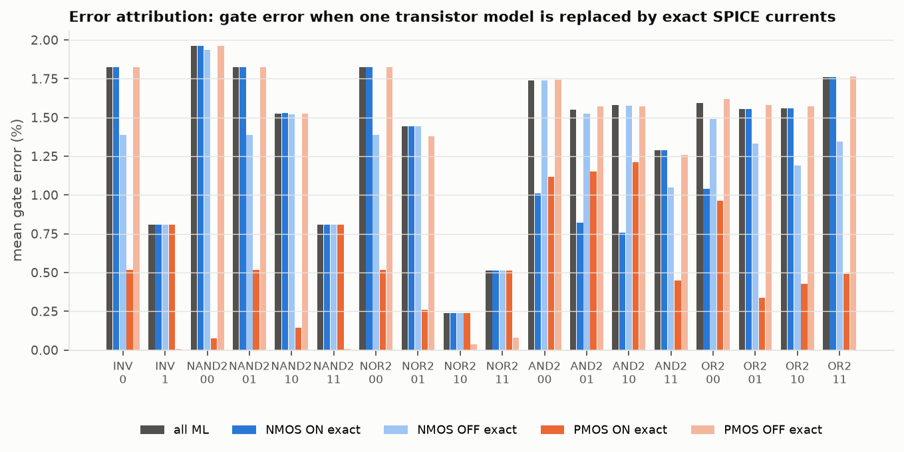 |

### 3.3 Part C: 3-bit CLA

| Comparison (12,800 runs) | Median error | P95 error | Mean accuracy | Bias |
|---|---|---|---|---|
| Spec method (sum of gate ML) vs full SPICE | 28.6 % | 63.3 % | 69.36 % | −28.6 % |
| ↳ ML vs sum of isolated-gate SPICE (ML error only) | 0.99 % | 5.01 % | 98.48 % | −0.73 % |
| ↳ Sum of isolated-gate SPICE vs full SPICE (method error) | 28.2 % | 62.9 % | 70.07 % | −28.2 % |
| **Loading-aware ML vs full SPICE** | **0.97 %** | **5.12 %** | **98.40 %** | −0.42 % |
| Isolated-gate SPICE + input currents vs full SPICE (check of loading model) | 0.003 % | 0.024 % | 99.99 % | 0.00 % |

The spec method's ~28 % under-estimate is almost all **method error**. A gate input held high
by another gate draws gate-tunnelling current from the driver's VDD, and the isolated-gate
model never counts it. Adding those input currents (loading-aware) recovers the full-netlist
leakage, and the error falls back to the gate-level ML error (≈ 1 %).

Rail check: across 499,200 gate outputs the median deviation from the ideal logic level is
0.33 µV, and the maximum is 18 µV (0.002 % of VDD).

| | |
|---|---|
| 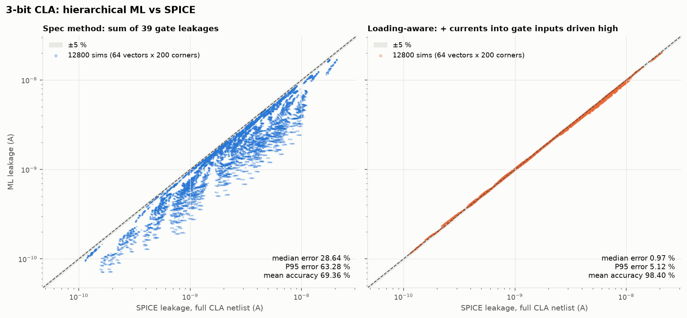 | 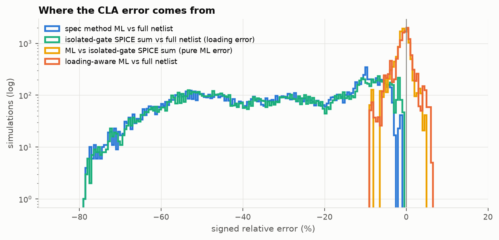 |
| 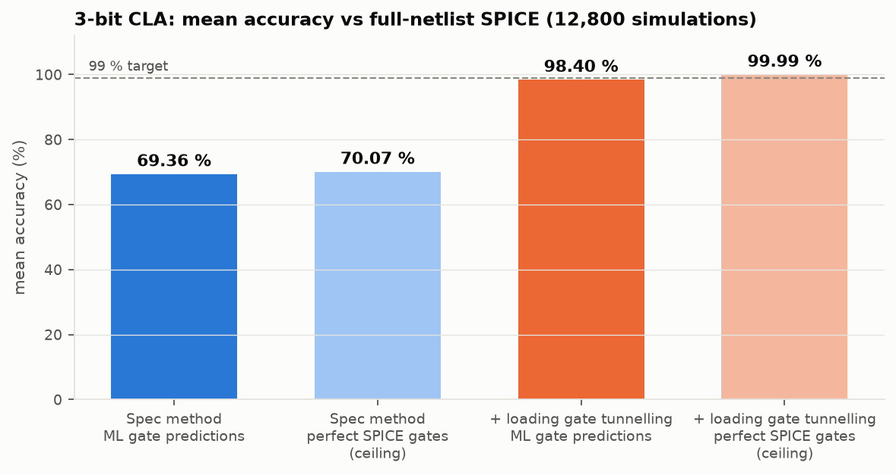 | 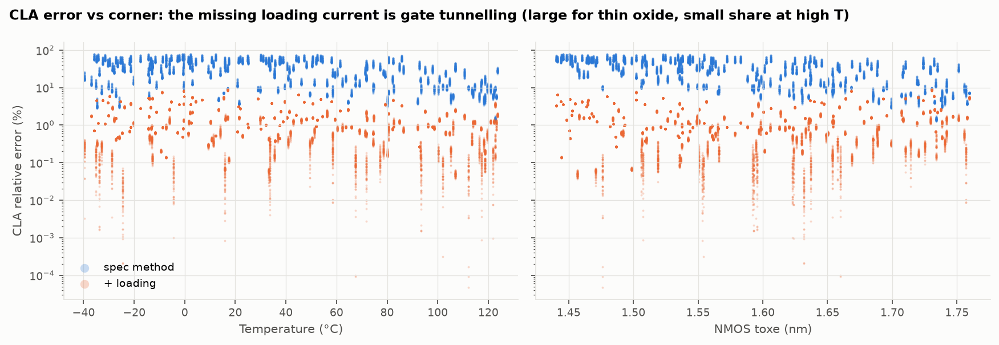 |

---

## 4. Limitations

* **Simulator resolution.** The card uses a gate resistance model (`rgatemod=1`). With the
  gate at ≈VDD, gate current can only be resolved to ~4.4e-16 A. PMOS OFF `ig` values near
  ±4e-16 A are round-off, not physics, so they are flagged rather than modelled.
* **Sampling.** Training data is uniform over bias. Logic gates operate at the rail corners,
  which uniform sampling barely covers (~4 in 10,000 samples). The Igc reformulation works
  around this, but the worst-case gate error is still ~9.6 %.
* **Spec method.** Summing isolated gates ignores inter-gate loading. We report it as
  specified, and the loading-aware variant alongside it.

---

## 5. Reproducing the results

All commands run from the repository root. Every stage skips work that is already done,
so it can be re-run after an interruption.

```bash
# Part A: transistor models
python -m layer1.scripts.generate_samples          # seeded samples
python -m layer1.scripts.generate_spice_data       # 40k ngspice runs (~5 min, 12 threads)
python -m layer1.scripts.validate_data             # data check, KCL, trend plots
python -m layer1.scripts.train_models              # 4 model types x 4 cases, selection, test
python -m layer1.scripts.plot_results              # parity / error-CDF / comparison plots

# Part B: gates
python -m layer2.scripts.generate_corners          # 200 corners (seed 31415)
python -m layer2.scripts.simulate_gates            # 3,600 SPICE runs + self-check
python -m layer2.scripts.predict_gate_leakage
python -m layer2.scripts.compare_gate_results
python -m layer2.scripts.error_attribution

# Part C: 3-bit CLA
python -m layer3.scripts.simulate_test_circuit     # 12,800 runs (~35 min)
python -m layer3.scripts.predict_circuit_leakage
python -m layer3.scripts.compare_circuit_results

# Report
python -m report.report_figures
python -m report.build_report                      # report/DVD_ML_Leakage_Report.docx
```

Useful options: `--case nmos_off`, `--limit N`, `--models mlp,hgb` (Part A);
`--gate nand2`, `--corner 17` (Part B simulation).

**Seeds:** Part A samples `20261115`, train/val/test split `42`, Part B/C corners `31415`.

**Large file:** `layer3/data/raw/part_c_spice.csv` (~370 MB of per-device diagnostics) is
git-ignored. The tracked `part_c_spice_summary.csv` holds everything needed for prediction,
resuming and analysis.

### Directory layout

```text
<repo root>/
├─ common_scripts/      shared code: config, model-card patching, ngspice runner, netlists,
│                       circuits, CLA, transistor model, gate ML, metrics, plotting, setup_check
├─ project_config.json  paths, ranges, seeds, tolerances
├─ 32nm_LP.pm           original model card (read-only)
├─ logs/                setup_check.json
├─ report/              report code, figures, DVD_ML_Leakage_Report.docx
├─ layer1/  Part A      scripts/ spice/ data/ models/ outputs/ logs/
├─ layer2/  Part B      scripts/ spice/ data/ outputs/ logs/
└─ layer3/  Part C      scripts/ spice/ data/ outputs/ logs/
```
